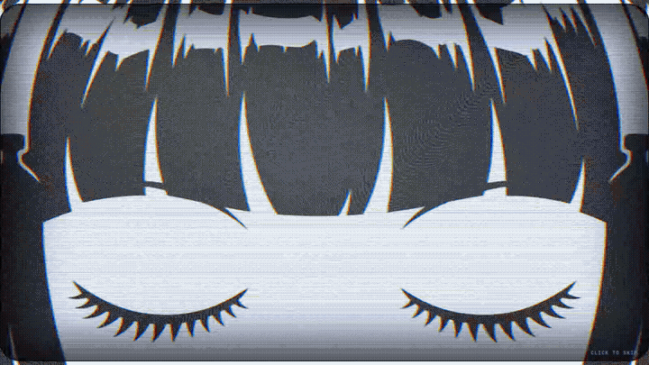

# Nous Wake

**The Nous girl wakes up every time you start a new Hermes chat.**

A three-second moment in Hermes Desktop: an old CRT switches on, the Nous girl fills the screen with her eyes
closed, her lids lift in five steps until she's looking right at you, and the tube switches off into your new chat.
It's drawn in the black-and-white Nous manga ink style.



## Install

```bash
hermes plugins install BkashJEE/hermes-nous-wake --enable
```

Then reload Hermes Desktop (Ctrl+R, or quit and reopen it) and click **New session**.

## What it does

- **Every new chat:** the sidebar's New session button, its shortcut and ⌘K all start a fresh chat, and each one plays
  the wake. It also plays once when Desktop opens on the new-chat screen. It works in every profile and bot.
- **Skip it:** click anywhere or press any key.
- **Choose when:** Settings ▸ Plugins ▸ Nous Wake: every new chat, the first chat of the day, app launch only, or off.
- **Replay:** the ◉ in the status bar, or ⌘K → "Nous Wake: watch her wake up".
- **Reduced motion:** with reduced motion turned on in your system, she fades in with her eyes open instead: no flicker,
  static or blinking.

Desktop only: no tools, no network calls, no model calls. `hermes plugins validate` passes (it stays inside the plugin SDK).

## How it works

- `desktop/plugin.src.js` is the source; `python3 build.py` writes `desktop/plugin.js` with the frames inlined as data
  URIs, because Desktop loads `plugin.js` on its own and can't fetch files next to it.
- New chats come from `host.state.activeSessionId`: a fresh chat draft sets it to empty.
- The full-window moment is the SDK's own `Dialog`, so the plugin never touches the app's markup.
- The CRT look is plain CSS (`desktop/crt.css`) plus an SVG colour-split filter.

## Artwork

The five frames (`art/frame-*.webp`) were made with Codex image generation from the official Nous girl artwork:
an open-eyed master first, then the other four from it with only the eyes changed.
`art/source/eyes.py` copies just the eye area of each frame onto the master, so her hair never moves between frames.
The prompts are in `art/source/`.

Inspired by DHH's Omarchy MacBook wake-up.

## Credits

- The Nous girl and her original artwork are by [Nous Research](https://github.com/NousResearch/hermes-agent) (MIT).
- Built by [@BkashJosi](https://x.com/BkashJosi). Independent, not affiliated with Nous Research.

MIT License.
